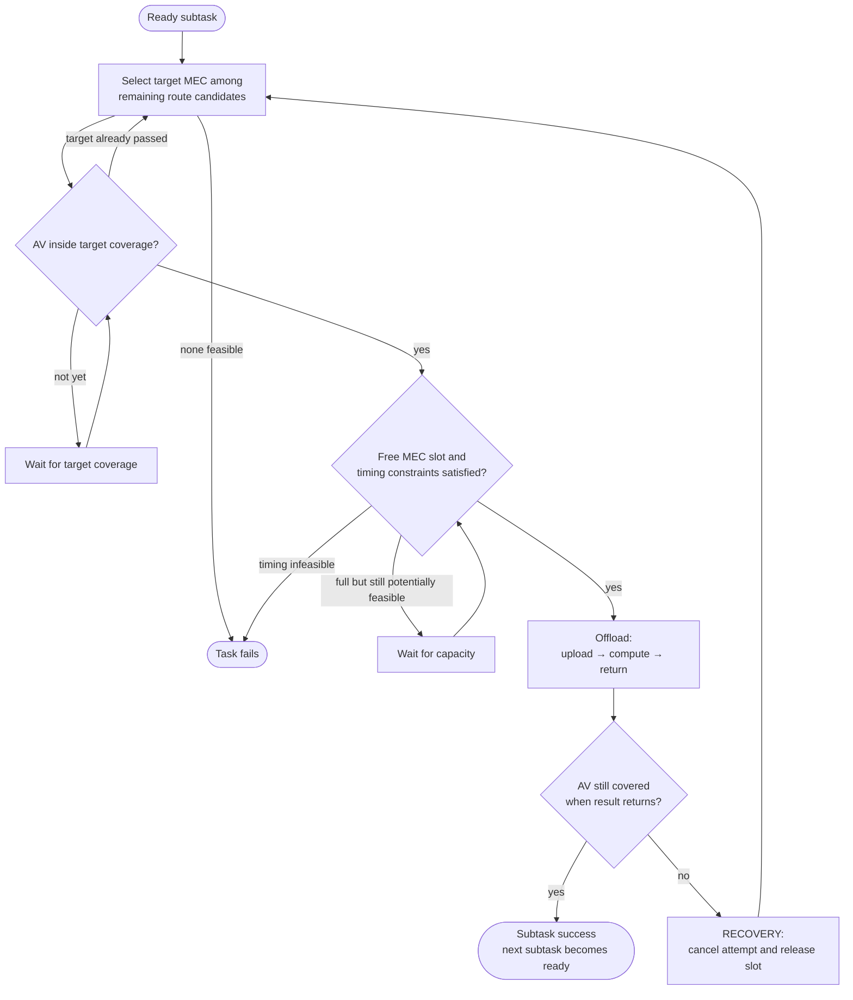

# RASMHA — Route-Aware Subtask MEC Heuristic Algorithm

This repository contains the implementation and experimental evaluation of **RASMHA**, a route-aware and deadline-aware mechanism for offloading computation tasks from autonomous vehicles (AVs) to **Multi-access Edge Computing (MEC)** servers over V2I links.

RASMHA uses the known route of each vehicle to identify the MEC servers that can be encountered along the trip. Whenever a subtask becomes ready, the algorithm proactively selects a target MEC — potentially before the vehicle enters its coverage — according to the earliest estimated completion time while respecting the subtask deadline and the task-level delay budget $\tau$.

The simulation runs online through **SUMO/TraCI** on a real road network of Kozani, Greece, derived from OpenStreetMap data. RASMHA is benchmarked against **CMHA** (Lai et al., 2024) under the same scenario, vehicle routes and generated task workload.

The code was developed as part of a diploma thesis at the University of Western Macedonia.

> [!NOTE]
> Runtime logs and some error messages are printed in Greek. Final report headings and tables are in English; CMHA failure reasons in `FAILURE ANALYSIS` are printed in Greek.

---

## Problem

Each AV generates computation tasks composed of sequentially dependent subtasks. In RASMHA, every subtask is executed remotely on a MEC server co-located with a base station (BS): the input data is uploaded through V2I, the subtask is computed at the MEC, and the result is returned to the vehicle.

A subtask attempt is considered successful only if the result is returned while the AV is still within the coverage of the same BS/MEC. Because the vehicle is continuously moving, selecting a server without accounting for mobility may lead to lost results, missed deadlines or repeated computation.

## Key idea

1. **Route awareness.** The vehicle route is used to derive the ordered set of MEC/BS candidates that the AV can encounter.
2. **Proactive target selection.** Whenever a subtask becomes ready, RASMHA selects the not-yet-passed MEC with the earliest estimated completion time that satisfies the timing constraints.
3. **Online admission control.** The selected target is not reserved in advance. The subtask starts only after the AV actually enters the target BS coverage, a MEC slot is available, and the real-time deadline checks still pass.
4. **Recovery.** If the AV leaves coverage before the result is returned, the running attempt is cancelled, the MEC slot is released, and the same subtask is reconsidered among the remaining feasible MECs along the route. This process may occur more than once.

**Design assumptions:** V2I communication only · MEC-only execution · sequential subtasks · no local processing in RASMHA · no caching · no RASMHA energy objective · no intermediate task-state migration · one MEC/BS serves each individual subtask attempt.

---

## Repository structure

```text
.
├── RASMHA.py       # Proposed algorithm + online SUMO/TraCI simulation
├── CMHA.py         # SUMO wrapper used to evaluate CMHA on the common scenario
├── CMHA_core.py    # CMHA Algorithm 1 implementation used by the wrapper
├── config.json     # Main scenario, workload and CMHA-comparison parameters
├── map.sumocfg     # SUMO configuration
└── map.net.xml     # Road network generated from OSM data with SUMO netconvert
```

`RASMHA.py` searches for `map.sumocfg`, `map.net.xml` and `config.json` in its own directory and, for convenience, in `Thesis/` and `sumo_scenario/` subdirectories. `CMHA.py` expects `CMHA_core.py` and `RASMHA.py` to be available in the same directory.

---

## Requirements

| Dependency           | Notes                                                                                                                 |
| -------------------- | --------------------------------------------------------------------------------------------------------------------- |
| Python ≥ 3.9         | The project code uses the Python standard library. No project-specific `pip install` is required.                     |
| Eclipse SUMO ≥ 1.20  | The supplied network was generated with SUMO 1.26. SUMO provides `sumo-gui`, `traci` and `sumolib`.                   |
| `SUMO_HOME`          | Environment variable pointing to the SUMO installation; the code loads `traci` and `sumolib` from `$SUMO_HOME/tools`. |
| `sumo-gui` on `PATH` | Required by the default interactive simulation configuration.                                                         |

---

## Installation

Install Eclipse SUMO and make sure its tools and executables are available to Python.

### Linux / macOS

```bash
export SUMO_HOME=/usr/share/sumo      # adjust to your installation
export PATH="$SUMO_HOME/bin:$PATH"
```

### Windows PowerShell

The SUMO installer normally configures `SUMO_HOME`. If it does not:

```powershell
$env:SUMO_HOME = "C:\Program Files (x86)\Eclipse\Sumo"
$env:Path = "$env:SUMO_HOME\bin;$env:Path"
```

### Verify the installation

```bash
sumo --version
python -c "import os, sys; sys.path.append(os.path.join(os.environ['SUMO_HOME'], 'tools')); import traci, sumolib; print('TraCI OK')"
```

---

## Usage

Run the proposed algorithm:

```bash
python RASMHA.py
```

Run the CMHA baseline on the same scenario and generated workload:

```bash
python CMHA.py
```

Each run opens **SUMO-GUI** with a simulation step length of **0.01 s**. Base stations are displayed as red markers and vehicles use the colours defined in `config.json`. The final report is printed to the terminal when the simulation ends.

### Saving results

```bash
python RASMHA.py > rasmha_results.txt
python CMHA.py   > cmha_results.txt
```

On Windows Command Prompt, UTF-8 output can be enabled before redirection:

```bat
set PYTHONUTF8=1
python RASMHA.py > rasmha_results.txt
python CMHA.py   > cmha_results.txt
```

### Headless mode

For faster non-interactive runs, change `"sumo-gui"` to `"sumo"` inside `prepare_sumo()` in `RASMHA.py`. `CMHA.py` reuses the same SUMO preparation function, so the same change applies to both simulations.

---

## How RASMHA works

### Setup (`prepare_sumo`)

The SUMO road network is loaded through `sumolib`. BS positions are converted from longitude/latitude to SUMO coordinates. For every AV:

* the configured origin and destination are matched to passenger-drivable road edges;
* the road route is computed using SUMO `findRoute`;
* the vehicle is inserted into the simulation at $t=0$;
* the route geometry is used to derive the ordered **route MEC candidates**, i.e. BSs whose coverage can intersect the vehicle route.

RASMHA does **not** precompute complete coverage windows or predicted exit times. Route geometry is used to determine which MECs are candidates and their route order. When a ready subtask must select a target, an approximate arrival time to each remaining candidate is estimated online.

### Online loop

At every simulation step, the scheduler performs the following operations:

1. Complete jobs whose planned `finish_time ≤ t`. A result is accepted only if the AV is still inside the corresponding BS coverage; otherwise recovery is triggered.
2. Handle AV arrivals at their destination. Unfinished tasks belonging to an arrived AV are marked as failed.
3. Update real BS coverage. When an AV leaves a BS, that BS is marked as passed; a subtask still running there enters recovery.
4. Generate tasks whose configured generation time has been reached.
5. Process every ready subtask and either select/wait for a target MEC, start an offload, trigger recovery or fail the task if no feasible continuation remains.

### Delay model

Each MEC server has total computing capacity $F_{total,b}$ and maximum concurrency $C_{max,b}$. Every active slot receives:

```math
f_b = \frac{F_{total,b}}{C_{max,b}}
```

For a subtask executed on MEC $b$, the service delay is:

```math
T_b =
\frac{D_{in}}{R_{V2I}}
+
\frac{\omega}{F_{total,b}/C_{max,b}}
+
\frac{D_{out}}{R_{V2I}}
```

where:

* $D_{in}$ is the subtask input size in bits,
* $D_{out}$ is the result size in bits,
* $\omega$ is the required number of CPU cycles,
* $R_{V2I}$ is the configured V2I transmission rate.

The total delay budget $\tau$ of a task containing $N$ sequential subtasks is divided proportionally. Subtask $k$ receives the absolute deadline:

```math
d_k = t_{gen} + \tau \frac{k}{N},
\qquad k=1,\ldots,N
```

### Target MEC selection

For each route MEC candidate $b$ that has not already been passed, RASMHA estimates when the AV can reach its coverage.

If the AV is already inside the BS coverage:

```math
\hat{t}^{arr}_b = t
```

Otherwise, the code approximates the remaining distance to the coverage entry point from the vehicle's current route position:

```math
\hat{t}^{arr}_b =
t +
\frac{\max\left(0,\;s_b-r_{cov}-s_{AV}\right)}{\bar{v}}
```

where:

* $s_b$ is the route position of the point closest to BS $b$,
* $s_{AV}$ is the current vehicle position along the route,
* $r_{cov}$ is the BS coverage radius,
* $\bar{v}$ is the average route speed, computed from route length and SUMO's estimated travel time.

The estimated start and finish times are:

```math
\hat{t}^{start}_b = \max\left(\hat{t}^{arr}_b,\;t_{dep}\right)
```

```math
\hat{t}^{fin}_b = \hat{t}^{start}_b + T_b
```

The selected target is:

```math
b^* = \arg\min_b \hat{t}^{fin}_b
```

subject to:

```math
\hat{t}^{fin}_b \le d_k
```

and

```math
\hat{t}^{fin}_b \le t_{gen}+\tau
```

where $t_{dep}$ is the time at which the previous sequential subtask has completed.

The MEC capacity is **not reserved at target-selection time**. The algorithm waits until the AV physically enters the selected BS coverage. Immediately before the offload starts, the real current time, available capacity, subtask deadline and task-level $\tau$ constraint are checked again.

### Per-subtask decision flow



---

## Baseline: CMHA

CMHA is based on the **Cache-assisted Mobility-aware Heuristic Algorithm** proposed by Lai et al. (2024).

### `CMHA_core.py`

`CMHA_core.py` implements the decision logic of Algorithm 1 together with the delay model, energy model and greedy cost-matrix selection using:

```math
G = \alpha T + (1-\alpha)E
```

Three practical implementation corrections are explicitly documented in the code:

1. the main loop terminates according to the number of decided tasks;
2. the capacity check is applied to the BS that actually performs the computation;
3. the capacity comparison uses strict `<` rather than `<=`.

The OPTA/ILP procedure and the Algorithm 2 stages are not used in the experimental comparison.

Running:

```bash
python CMHA_core.py
```

executes the standalone example included in that file.

### `CMHA.py`

`CMHA.py` bridges the CMHA implementation and the common SUMO scenario. The wrapper constructs the required CMHA inputs, invokes `cmha()`, and then executes the **LOCAL / ACCESS / MIGRATION** decision returned by the algorithm; it does not replace that returned decision with RASMHA logic.

The wrapper:

* dynamically loads `CMHA_core.py` and `RASMHA.py`;
* reuses the same vehicles, routes, MEC servers, task templates and SUMO setup as RASMHA;
* presents each ready RASMHA subtask to CMHA as an independent CMHA task, while sequential dependencies are enforced externally by the wrapper;
* selects the current **Access BS** as the nearest reachable BS;
* selects the **Migration BS** as the next available BS along the route;
* computes residence time $T_w$ from the route/coverage intersection and the average vehicle speed;
* invokes `cmha()` once per simulation step for the batch of ready subtasks;
* executes the resulting CMHA decisions without adding RASMHA recovery.

At the last usable BS on a route, where no future migration BS exists, the wrapper uses $k=j$ and $T_w=\infty$ as an input encoding that disables migration while leaving `cmha()` unchanged.

For a CMHA **MIGRATION** decision, the computation/result path is evaluated according to the CMHA migration model and the result becomes deliverable when the AV reaches the Migration BS coverage. This adapts the execution of the paper's migration model to a road scenario whose BS coverage areas are not necessarily contiguous.

### RASMHA vs CMHA

| Feature                   | RASMHA                                                                                                 | CMHA baseline                                                             |
| ------------------------- | ------------------------------------------------------------------------------------------------------ | ------------------------------------------------------------------------- |
| MEC selection             | Proactive selection among all remaining route candidates                                               | Current Access BS or one planned Migration BS                             |
| Mobility information      | Known route + average-speed arrival estimate                                                           | Residence time $T_w$ at Access BS                                         |
| Decision criterion        | Earliest estimated completion subject to deadline and $\tau$                                           | Minimum greedy cost $\alpha T + (1-\alpha)E$                              |
| Local execution           | No                                                                                                     | Supported by CMHA                                                         |
| Caching                   | No                                                                                                     | Supported; disabled in the reported experiments with `cache_hit_rate = 0` |
| Energy objective          | No                                                                                                     | Yes                                                                       |
| Mobility failure handling | Cancel failed attempt and reselect among remaining feasible route MECs; multiple attempts are possible | No recovery loop; at most one pre-planned migration hop per decision      |
| Decision unit             | Individual ready subtask                                                                               | Batch of ready subtasks at each simulation step                           |

### Reproducibility

Task generation uses a deterministic seeded random generator (`task_generation.seed`). Because `CMHA.py` imports the same `TASK_TEMPLATES` from `RASMHA.py`, both algorithms receive the same generated workload for a given configuration.

CMHA-specific local CPU values, transmit-power values and cache states are also generated deterministically from the configured seed.

At the beginning of a CMHA run, the wrapper prints the SHA-256 hashes of both `CMHA_core.py` and the referenced `RASMHA.py`, making the exact evaluated code versions traceable.

---

## Configuration (`config.json`)

All **main scenario, workload and CMHA-comparison parameters** are defined in `config.json`. Changing those values is sufficient to define a new experimental scenario; SUMO execution details such as the default `sumo-gui` binary and the 0.01 s simulation step are currently defined in the Python code.

> [!NOTE]
> The `config.json` included with the current repository corresponds to the most demanding reported scenario, **S3**: 6 AVs, 7 MEC servers, 100 m coverage radius and 10 Mbps V2I rate.

> [!NOTE]
> Vehicle and BS coordinates must lie inside the supplied map, approximately within 21.7755–21.8480 E and 40.2940–40.3148 N.

### `scenario`

| Key                                 |     Unit | Description                                                                            |
| ----------------------------------- | -------: | -------------------------------------------------------------------------------------- |
| `number_of_vehicles`                |        — | Number of AVs. Must match the number of entries in `vehicles`; validated at load time. |
| `vehicles[].av_id`                  |        — | Unique AV identifier. The corresponding SUMO vehicle is named `av<id>`.                |
| `vehicles[].start_lon`, `start_lat` |    WGS84 | Vehicle origin coordinates.                                                            |
| `vehicles[].end_lon`, `end_lat`     |    WGS84 | Vehicle destination coordinates.                                                       |
| `vehicles[].color`                  |     RGBA | Optional vehicle colour used in SUMO-GUI.                                              |
| `bs_coverage_m`                     |        m | Radius of the circular BS coverage model.                                              |
| `v2i_rate`                          |    bit/s | Constant V2I rate used for input upload and result return.                             |
| `mec_servers[].bs_id`               |        — | Unique BS/MEC identifier.                                                              |
| `mec_servers[].lon`, `lat`          |    WGS84 | MEC/BS geographical coordinates.                                                       |
| `mec_servers[].F_total`             | cycles/s | Total MEC computing capacity.                                                          |
| `mec_servers[].C_max`               |     jobs | Maximum number of simultaneous MEC jobs. Each slot receives `F_total / C_max`.         |
| `max_sim_time`                      |        s | Maximum simulation duration.                                                           |
| `wait_log_period`                   |        s | Minimum interval between repeated waiting messages for the same subtask.               |

### `task_generation`

| Key                            |       Unit | Description                                                                                                                                                  |
| ------------------------------ | ---------: | ------------------------------------------------------------------------------------------------------------------------------------------------------------ |
| `seed`                         |          — | Seed used by the workload generator.                                                                                                                         |
| `start_time`                   |          s | First nominal task-generation time.                                                                                                                          |
| `end_time`                     |          s | Last nominal generation round. Tasks whose jittered generation time exceeds `end_time` are dropped, so with `jitter > 0` the round at exactly `end_time` generates no tasks. |
| `interval`                     |          s | Time between successive generation rounds. One task is generated for each configured AV per round.                                                           |
| `jitter`                       |          s | Random offset sampled from $U(0,\text{jitter})$ and added to each task generation time; tasks pushed past `end_time` are dropped.                          |
| `min_subtasks`, `max_subtasks` |          — | Minimum and maximum number of sequential subtasks per generated task.                                                                                        |
| `D_in_range`                   |       bits | Range from which each subtask input size is sampled.                                                                                                         |
| `D_out`                        |       bits | Fixed result size returned by each subtask.                                                                                                                  |
| `omega_range`                  | CPU cycles | Range from which each subtask computational load is sampled.                                                                                                 |
| `tau_range`                    |          s | Range from which the total task delay budget $\tau$ is sampled.                                                                                              |

### `cmha_comparison`

These values are used by `CMHA.py` only.

| Key               |     Unit | Description                                                                                                                                          |
| ----------------- | -------: | ---------------------------------------------------------------------------------------------------------------------------------------------------- |
| `alpha`           |        — | Delay weight in $\alpha T + (1-\alpha)E$.                                                                                                            |
| `bs_to_bs_rate`   |    bit/s | Inter-BS transmission rate used by the CMHA migration model.                                                                                         |
| `cache_hit_rate`  |      0–1 | Probability that a result is cached for a `(BS, task type)` pair. The reported comparison uses 0 to disable caching and isolate mobility management. |
| `num_task_types`  |        — | Number of task types used by the CMHA cache model.                                                                                                   |
| `local_cpu_range` | cycles/s | Range used to assign local AV CPU capacities for the CMHA LOCAL option.                                                                              |
| `tx_power_range`  |        W | Range used to assign AV transmit power for the CMHA energy model.                                                                                    |

---

## Simulation output

During execution, the programs print a chronological log containing task generation, target selection, coverage entries/exits, offloads, migrations or recoveries, completions and failures.

The final report contains:

| Section                    | Contents                                                                                                                                                    |
| -------------------------- | ----------------------------------------------------------------------------------------------------------------------------------------------------------- |
| `SIMULATION CONFIGURATION` | Main parameters of the run.                                                                                                                                 |
| `TASK RESULTS`             | Per-task generation time, execution/MEC sequence, waiting time, service time, E2E delay, $\tau$ and final status.                                           |
| `SYSTEM SUMMARY`           | Completed/failed task counts, success/failure rates, mean, median, minimum, maximum and total completed-task E2E delay.                                     |
| `ORIGINAL CMHA METRICS`    | CMHA only: LOCAL/ACCESS/MIGRATION counts, cache hits, total task energy, selected cost and exact evaluated cost.                                            |
| `MEC UTILIZATION`          | Number and share of subtask assignments recorded per MEC in the final simulation state. This is an assignment statistic, not instantaneous CPU utilisation. |
| `FAILURE ANALYSIS`         | Failed-task information and the first relevant failed/uncompleted subtask reported by each implementation.                                                  |

### Counting RASMHA recovery activations

Linux / macOS:

```bash
grep -c "RECOVERY" rasmha_results.txt
```

Windows PowerShell:

```powershell
(Select-String "RECOVERY" rasmha_results.txt).Count
```

---

## Reported experimental results

The thesis evaluates three scenarios of increasing difficulty. Across the scenarios, the number of vehicles and computational workload increase, while BS coverage, V2I rate and timing margins become more demanding.

| Scenario           | Vehicles | RASMHA success rate | CMHA success rate | RASMHA recovery activations |
| ------------------ | -------: | ------------------: | ----------------: | --------------------------: |
| S1                 |        2 |                100% |              100% |                           0 |
| S2                 |        4 |                 95% |               75% |                           7 |
| S3 (`config.json`) |        6 |                 80% |               30% |                          38 |

The included `config.json` is the **S3 configuration**. S1 and S2 were evaluated with the same code using different configuration values documented in the thesis; they are reported here as experimental results rather than as additional configuration files bundled with this repository.

As mobility pressure increases, the RASMHA recovery mechanism is activated more frequently and the two algorithms exhibit increasingly different completion rates. The detailed per-task failure analysis is provided in Chapter 5 of the thesis.

### CMHA selected cost vs exact evaluated cost

The reported gap between the cost used by CMHA during greedy decision making and the exact post-decision evaluated cost is:

| Scenario | Relative gap |
| -------- | -----------: |
| S1       |           0% |
| S2       |      ≈ 29.0% |
| S3       |      ≈ 53.4% |

The difference is associated with migration decisions. `CMHA_core.py` preserves the migration cost expression used by Algorithm 1 for decision-time selection, while the exact evaluator applies the full migration delay model for the final `Y/Z` decisions. With caching disabled, the difference becomes visible when cache-miss migration decisions occur and increases in the more demanding scenarios.

---

## Known limitations

* **Possible unnecessary waiting after proactive target selection.** RASMHA may select a future MEC with a better estimated completion time and wait for it even when another MEC is already reachable.
* **Approximate arrival estimation.** Future target arrival uses average route speed and a geometric approximation of the coverage entry point. Dynamic queues, traffic signals and short-term speed fluctuations are not predicted.
* **Discrete simulation time.** Completion and coverage checks are evaluated once every 0.01 s, so events exactly at a coverage boundary may be detected on the following simulation step.
* **Idealised V2I model.** BS coverage is circular and the configured V2I rate is constant; interference, fading, radio contention and adaptive data rates are not modelled.
* **No intermediate-state migration in RASMHA.** Recovery restarts the failed subtask from scratch on a newly selected MEC rather than moving partial computation state.
* **Completed-task delay statistics.** Mean and median E2E delay are calculated only over completed tasks. When success rates differ substantially, delay averages should therefore be interpreted together with the completion rate.
* **CMHA adaptation to sequential subtasks.** CMHA was originally formulated for independent tasks. In this comparison, each ready subtask is presented to CMHA as an independent task and the original task dependencies are enforced externally by the SUMO wrapper.
* **Scenario files.** Only the current `config.json` is bundled. The S1 and S2 results correspond to earlier parameterisations of the same configuration structure.

---

## Troubleshooting

| Error                                                | Cause / fix                                                                                                                |
| ---------------------------------------------------- | -------------------------------------------------------------------------------------------------------------------------- |
| `EnvironmentError: SUMO_HOME is not set`             | Set the `SUMO_HOME` environment variable as described in [Installation](#installation).                                    |
| `FileNotFoundError` when starting SUMO               | Verify that the SUMO `bin` directory is on `PATH`.                                                                         |
| `Δεν βρέθηκε το map.net.xml`                         | Ensure the file is named exactly `map.net.xml` and is located next to the Python files or in `Thesis/` / `sumo_scenario/`. |
| `number_of_vehicles=…, αλλά στο vehicles υπάρχουν …` | `number_of_vehicles` does not match the length of the `vehicles` list in `config.json`.                                    |
| `Δεν βρέθηκε drivable edge κοντά στο …`              | The configured coordinate is outside the map or too far from a passenger-drivable road edge.                               |
| `Δεν βρέθηκε διαδρομή για AV …`                      | SUMO cannot find a valid road connection between the selected origin and destination.                                      |
| Garbled Greek characters in redirected output        | On Windows, enable UTF-8 with `set PYTHONUTF8=1` before running the command.                                               |

---

## Citation

The CMHA baseline is based on:

> S. Lai, L. Huang, Q. Ning, and C. Zhao, “Mobility-aware task offloading in MEC with task migration and result caching,” *Ad Hoc Networks*, vol. 156, 103411, 2024. https://doi.org/10.1016/j.adhoc.2024.103411

```bibtex
@article{lai2024mobility,
  author  = {Lai, Suling and Huang, Linyu and Ning, Qian and Zhao, Chengping},
  title   = {Mobility-aware task offloading in {MEC} with task migration and result caching},
  journal = {Ad Hoc Networks},
  volume  = {156},
  pages   = {103411},
  year    = {2024},
  doi     = {10.1016/j.adhoc.2024.103411}
}
```

If you use RASMHA or the accompanying simulation code, please cite the diploma thesis:

```bibtex
@mastersthesis{karatsiolis2026rasmha,
  author  = {Karatsiolis, Konstantinos},
  title   = {Ανάθεση Υπολογιστικής Εργασίας σε MEC Server κατά Μήκος Διαδρομής σε V2I Περιβάλλοντα},
  school  = {University of Western Macedonia},
  type    = {Diploma Thesis},
  address = {Kozani, Greece},
  year    = {2026},
  note    = {English title: Computational Task Assignment to MEC Servers Along a Route in V2I Environments}
}
```

---

## Author

**Konstantinos Karatsiolis**
Diploma Thesis — Department of Electrical and Computer Engineering, University of Western Macedonia

**Supervisor:** Panagiotis Sarigiannidis, Professor
