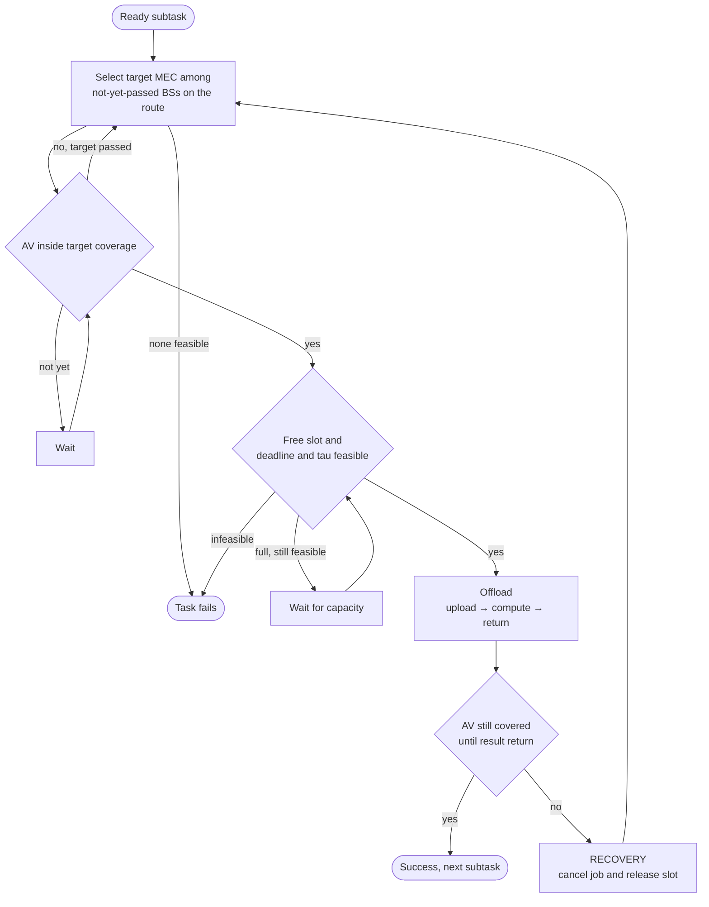

# RASMHA — Route-Aware MEC Task Offloading for Autonomous Vehicles


This repository contains the implementation and experimental evaluation of **RASMHA**, a route-aware, deadline-aware mechanism for offloading computation tasks from autonomous vehicles (AVs) to Mobile Edge Computing (MEC) servers over V2I links. RASMHA exploits the vehicle's known route to decide in advance where each subtask should run. The simulation runs online on a real road network of Kozani, Greece (OpenStreetMap) through SUMO/TraCI, and RASMHA is benchmarked against **CMHA** (Lai et al., 2024) under the **same scenario, vehicles and task workload**.

The code was developed as part of a diploma thesis.

> [!NOTE]
> Runtime logs and some error messages are printed in Greek. The final report tables are in English.

---

## Problem

Each AV generates tasks made of sequentially dependent subtasks. For every subtask, the input data is uploaded to a MEC server co-located with a base station (BS), processed there, and the result must be returned to the vehicle **while it is still inside the coverage of the same BS**. Because the vehicle is moving, a MEC selection that ignores mobility leads to lost results and missed deadlines.

## Key idea

1. **Route awareness.** The ordered list of MEC servers the AV will pass is derived from its route.
2. **Proactive selection.** For each ready subtask, a target MEC is chosen with the earliest estimated completion time, subject to the subtask deadline and the task's total delay budget τ.
3. **Online admission control.** The subtask is offloaded only once the AV has actually entered the target's coverage, and only if a free slot is available.
4. **Recovery.** If the AV leaves coverage before the result is returned, the job is cancelled, the slot is released, and the same subtask is restarted from scratch on the next suitable MEC along the route, as many times as needed.

**Design assumptions:** V2I communication only · MEC-only execution (no local processing) · no caching · no energy model · no intermediate state migration · each subtask is served within a single BS coverage window.

---

## Repository structure

```
.
├── RASMHA.py       # Proposed algorithm + online SUMO/TraCI simulation
├── CMHA.py         # Wrapper that runs CMHA in the same SUMO scenario
├── CMHA_core.py    # CMHA implementation (Algorithm 1, Lai et al. 2024)
├── config.json     # Single configuration file: scenario, workload, CMHA settings
├── map.sumocfg     # SUMO configuration
└── map.net.xml     # Road network (OSM → netconvert)
```

`RASMHA.py` looks for `map.sumocfg`, `map.net.xml` and `config.json` in its own directory or in the `Thesis/` and `sumo_scenario/` subdirectories. `CMHA.py` requires `CMHA_core.py` and `RASMHA.py` to be in the same directory.

## Requirements

| Dependency | Notes |
|---|---|
| Python ≥ 3.9 | Standard library only, no `pip install` needed. |
| [Eclipse SUMO](https://eclipse.dev/sumo/) ≥ 1.20 | The network was built with SUMO 1.26. Provides `sumo-gui`, `traci` and `sumolib`. |
| `SUMO_HOME` | Environment variable pointing to the SUMO installation; `traci`/`sumolib` are loaded from there. |
| `sumo-gui` on `PATH` | Required to launch the simulation through TraCI. |

## Installation

```bash
git clone https://github.com/<username>/<repository>.git
cd <repository>
```

**Linux / macOS**

```bash
export SUMO_HOME=/usr/share/sumo      # adjust to your installation
export PATH="$SUMO_HOME/bin:$PATH"
```

**Windows (PowerShell).** The SUMO installer usually sets `SUMO_HOME` automatically. Otherwise:

```powershell
$env:SUMO_HOME = "C:\Program Files (x86)\Eclipse\Sumo"   # or your install path
$env:Path = "$env:SUMO_HOME\bin;$env:Path"
```

**Verify**

```bash
sumo --version
python -c "import os, sys; sys.path.append(os.path.join(os.environ['SUMO_HOME'], 'tools')); import traci, sumolib; print('TraCI OK')"
```

## Usage

```bash
python RASMHA.py    # proposed algorithm
python CMHA.py      # baseline
```

Each run opens SUMO-GUI (step length 0.01 s), with base stations shown as red markers and vehicles coloured as defined in `config.json`. If the simulation does not start automatically, press ▶ **Run**. The final report is printed to the terminal when the run ends.

**Saving results**

```bash
python RASMHA.py > rasmha_results.md
python CMHA.py   > cmha_results.md
```

On Windows, run the redirection from Command Prompt so the Greek log messages are written correctly:

```bat
set PYTHONUTF8=1
python RASMHA.py > rasmha_results.md
```

**Headless mode.** For faster runs, change `"sumo-gui"` to `"sumo"` in `prepare_sumo()` in `RASMHA.py`. The change also applies to CMHA, since the wrapper reuses the same function.

---

## How RASMHA works

### Setup (`prepare_sumo`)

The network is loaded with `sumolib` and BS positions are converted from lon/lat to SUMO coordinates (metres). For each AV, the origin and destination are snapped to the nearest passenger-drivable edge, the route is computed with `findRoute`, and the vehicle is inserted at t = 0. From the route geometry, the **route MEC candidates** are derived: the base stations whose coverage circle intersects the route, sorted in the order the vehicle will encounter them. No entry or exit times are predicted; geometry only determines which MECs are candidates and in what order.

### Online loop (every simulation step)

1. Complete jobs with `finish_time ≤ t`. A result counts as delivered only if the AV is still inside the coverage of the same BS; otherwise recovery is triggered.
2. Handle arrivals. When an AV reaches its destination, its unfinished tasks fail.
3. Update coverage. When the AV leaves a BS, that BS is marked as *passed*, and any job running there goes into recovery.
4. Generate tasks from templates pre-built from `config.json`.
5. Make a decision for every ready subtask (see the flowchart below).

### Delay model

Each MEC splits its computing capacity equally among its `C_max` slots, so the service delay of a subtask on MEC $`b`$ is:

```math
T_b = \frac{D_{in}}{R_{V2I}} + \frac{\omega}{F_{total,b} / C_{max,b}} + \frac{D_{out}}{R_{V2I}}
```

The total delay budget τ of a task with $`N`$ subtasks is split proportionally, so subtask $`k`$ has the absolute deadline:

```math
d_k = t_{gen} + \tau \cdot \frac{k}{N}, \qquad k = 1, \dots, N
```

### Target MEC selection

For every MEC $`b`$ on the route that has not been passed yet, the arrival time into its coverage is estimated. If the AV is already inside coverage, $`\hat{t}^{arr}_b = t`$; otherwise:

```math
\hat{t}^{\,arr}_b = t + \frac{\max\left(0,\; s_b - r_{cov} - s_{AV}\right)}{\bar{v}}
```

where $`s_b`$ is the position along the route of the point closest to the BS, $`s_{AV}`$ is the vehicle's current position along the route, $`r_{cov}`$ is the coverage radius, and $`\bar{v}`$ is the average speed (route length divided by SUMO's estimated travel time). The MEC with the earliest estimated completion that satisfies both timing constraints is selected:

```math
\hat{t}^{\,fin}_b = \max\left(\hat{t}^{\,arr}_b,\; t_{dep}\right) + T_b,
\qquad
b^{*} = \arg\min_{b} \hat{t}^{\,fin}_b
\;\; \text{s.t.} \;\; \hat{t}^{\,fin}_b \le d_k,\;\; \hat{t}^{\,fin}_b \le t_{gen} + \tau
```

where $`t_{dep}`$ is the completion time of the previous subtask. Capacity is **not** reserved at selection time. It is committed only when the job actually starts (`start_job`), at which point the deadline and τ are re-checked against the real simulation time.

### Per-subtask decision flow



---

## Baseline: CMHA

### `CMHA_core.py`

Implementation of Algorithm 1 (Cache-assisted Mobility-aware Heuristic Algorithm) by Lai et al.: delay model (Eqs. 7–16), energy model (Eqs. 18–19), and greedy selection over a cost matrix G with cost α·T + (1−α)·E. Three practical corrections are applied and documented in the code: the main loop terminates on the number of decided tasks, the capacity check targets the BS that actually computes the task, and the capacity check uses a strict `<`. OPTA/ILP and the Algorithm 2 stages exist only as placeholders and are not used in the comparison. Running `python CMHA_core.py` executes a small standalone example.

### `CMHA.py`

A bridge between CMHA and SUMO that **does not alter any decision of the algorithm**:

- Dynamically loads `CMHA_core.py` and `RASMHA.py` and reuses the scenario, `TASK_TEMPLATES` and `prepare_sumo()`, so vehicles, routes, base stations and tasks are identical to RASMHA's.
- Since CMHA is coarse-grained, each ready subtask is passed to it as an independent task; dependencies between subtasks are enforced by the wrapper.
- The Access BS is the nearest BS in range, and the Migration BS is the next available BS along the route. The residence time T<sub>w</sub> is computed from the route–coverage intersection and the average speed. At the last BS on the route, migration is disabled (k = j, T<sub>w</sub> = ∞).
- `cmha()` is called once per step for all ready subtasks, and the resulting LOCAL / ACCESS / MIGRATION decisions are executed unchanged.
- For MIGRATION, the result is delivered when the AV enters the Migration BS coverage. This generalises Eq. 16 of the paper, because coverage areas in this scenario are not contiguous.

### RASMHA vs CMHA

| | RASMHA | CMHA |
|---|---|---|
| MEC selection | Proactive, among all not-yet-passed BSs on the route | Access BS or a single Migration BS |
| Mobility information | Route and average speed | Residence time T<sub>w</sub> |
| Decision criterion | Earliest estimated completion under deadline and τ | Minimum α·T + (1−α)·E (greedy) |
| Local execution | No | Yes (LOCAL) |
| Caching | No | Yes (here `cache_hit_rate = 0`) |
| Energy | No | Yes |
| Coverage exit during execution | Recovery on the next MEC, multiple attempts | No recovery; one pre-planned migration hop |
| Decision unit | Per subtask | Batch of ready subtasks per step |

### Reproducibility

The task workload is generated by a seeded RNG (`task_generation.seed`) and consumed unchanged by both algorithms. CMHA's device parameters (local CPU, transmit power, cache state) are also derived deterministically from the same seed. At the start of every run, the CMHA wrapper prints the SHA-256 hashes of `CMHA_core.py` and `RASMHA.py`, documenting exactly which code version produced each result.

---

## Configuration (`config.json`)

All parameters live in a single file. Defining a new scenario requires no code changes.

> [!NOTE]
> Vehicle and BS coordinates must lie inside the map, roughly 21.7755–21.8480 E and 40.2940–40.3148 N.

### `scenario`

| Key | Unit | Description |
|---|---|---|
| `number_of_vehicles` | — | Must match the length of `vehicles` (validated on load). |
| `vehicles[].av_id` | — | Unique identifier; the SUMO vehicle is named `av<id>`. |
| `vehicles[].start_lon`, `start_lat`, `end_lon`, `end_lat` | WGS84 | Origin and destination, snapped to the nearest road edge (search radius up to ~500 m). |
| `vehicles[].color` | RGBA | Optional colour in SUMO-GUI. |
| `bs_coverage_m` | m | Radius of each BS's circular coverage. |
| `v2i_rate` | bit/s | Constant V2I rate for upload and result return. |
| `mec_servers[].bs_id`, `lon`, `lat` | —, WGS84 | BS/MEC identifier and position. |
| `mec_servers[].F_total` | cycles/s | Total computing capacity of the MEC. |
| `mec_servers[].C_max` | — | Maximum concurrent jobs; each job receives `F_total / C_max`. |
| `max_sim_time` | s | Upper bound on simulation time. |
| `wait_log_period` | s | Minimum interval between repeated waiting messages for the same subtask. |

### `task_generation`

| Key | Unit | Description |
|---|---|---|
| `seed` | — | Seed of the task generator. |
| `start_time`, `end_time`, `interval` | s | Every `interval` seconds, from `start_time` to `end_time`, one task is generated per AV. |
| `jitter` | s | Random offset U(0, jitter) added to the generation time; tasks pushed past `end_time` are dropped. |
| `min_subtasks`, `max_subtasks` | — | Range of the number of sequential subtasks per task. |
| `D_in_range` | bits | Range of input size per subtask. |
| `D_out` | bits | Result size per subtask. |
| `omega_range` | CPU cycles | Range of computational load per subtask. |
| `tau_range` | s | Range of the total delay budget τ per task. |

### `cmha_comparison` (used by `CMHA.py` only)

| Key | Unit | Description |
|---|---|---|
| `alpha` | — | Delay weight in the cost α·T + (1−α)·E. |
| `bs_to_bs_rate` | bit/s | Inter-BS transfer rate during migration. |
| `cache_hit_rate` | 0–1 | Probability of a cached result per (BS, task type) pair. A value of 0 disables caching for a fair comparison. |
| `num_task_types` | — | Number of task types in the cache model. |
| `local_cpu_range` | cycles/s | Local computing capacity of each AV (LOCAL option). |
| `tx_power_range` | W | Transmit power of each AV (energy model). |

---

## Simulation output

During execution, a chronological log is printed: task creation, target selection, coverage entries and exits, offloads, recoveries, completions and failures. It is followed by the final report:

| Section | Contents |
|---|---|
| `SIMULATION CONFIGURATION` | Key parameters of the run. |
| `TASK RESULTS` | Per task: MEC sequence, generation and completion times, waiting, service, E2E delay, τ, status (`COMPLETED`, `TAU MISSED`, `FAILED`). |
| `SYSTEM SUMMARY` | Success and failure rates; mean, median, minimum and maximum E2E delay of completed tasks. |
| `ORIGINAL CMHA METRICS` | CMHA only: number of LOCAL, ACCESS and MIGRATION decisions, cache hits, energy, decision-time cost and evaluated cost. |
| `MEC UTILIZATION` | Cumulative number of assignments per BS (not instantaneous load). |
| `FAILURE ANALYSIS` | First failed subtask per task and whether it failed before or after assignment. |

Counting recovery activations:

```bash
grep -c "RECOVERY" rasmha_results.md                  # Linux / macOS
(Select-String "RECOVERY" rasmha_results.md).Count    # Windows PowerShell
```

## Results

Three scenarios of increasing difficulty: more vehicles, smaller coverage and V2I rate, heavier tasks, tighter deadlines.

| Scenario | Vehicles | RASMHA success rate | CMHA success rate | Recovery activations (RASMHA) |
|---|:---:|:---:|:---:|:---:|
| S1 | 2 | 100 % | 100 % | 0 |
| S2 | 4 | 95 % | 75 % | 7 |
| S3 (`config.json`) | 6 | 80 % | 30 % | 38 |

RASMHA's advantage appears precisely when the recovery mechanism is triggered, and the number of activations explains the divergence in success rates. In addition, the gap between the cost CMHA estimates at decision time and the cost actually evaluated grows with difficulty (0 % → 29 % → 53.4 %), as migrations invalidate the initial estimates. The full analysis is in Chapter 5 of the thesis.

## Known limitations

- **Unnecessary waiting from proactive selection.** In some cases RASMHA waits for its target MEC even though an already reachable MEC could serve the subtask immediately. The pattern appears consistently across all scenarios.
- **Discrete time.** Completion and coverage checks run once per simulation step (0.01 s), so a job finishing right at the coverage boundary may be evaluated one step later.
- **Arrival estimation.** It relies on the average route speed and ignores queues and traffic lights.
- **Idealised wireless channel.** Circular coverage, constant V2I rate, no interference or channel contention.
- **Survivor bias in mean E2E delay.** It is computed over completed tasks only, so when success rates differ widely, comparing means favours the algorithm with more failures.
- **CMHA adaptation.** CMHA was designed for independent tasks; here each subtask is fed to it as a separate task and dependencies are enforced externally.

## Troubleshooting

| Error | Cause and fix |
|---|---|
| `EnvironmentError: SUMO_HOME is not set` | Set the `SUMO_HOME` environment variable (see [Installation](#installation)). |
| `FileNotFoundError` when SUMO starts | `sumo-gui` is not on `PATH`; add SUMO's `bin` directory. |
| `Δεν βρέθηκε το map.net.xml` ("map.net.xml not found") | The file must be named exactly `map.net.xml` and sit next to the `.py` files or in `Thesis/` or `sumo_scenario/`. |
| `number_of_vehicles=…, αλλά στο vehicles υπάρχουν …` | Vehicle count mismatch in `config.json`. |
| `Δεν βρέθηκε drivable edge κοντά στο …` ("no drivable edge near …") | Coordinates are outside the map or too far from a road. |
| `Δεν βρέθηκε διαδρομή για AV …` ("no route found for AV …") | No road connection between origin and destination (e.g. one-way streets); move the points. |
| Garbled Greek characters in the output file | On Windows, set `PYTHONUTF8=1` and redirect from Command Prompt. |

---

## Citation

CMHA is based on:

> S. Lai, L. Huang, Q. Ning, C. Zhao, "Mobility-aware task offloading in MEC with task migration and result caching," *Ad Hoc Networks*, vol. 156, 103411, 2024.

```bibtex
@article{lai2024mobility,
  author  = {Lai, S. and Huang, L. and Ning, Q. and Zhao, C.},
  title   = {Mobility-aware task offloading in {MEC} with task migration and result caching},
  journal = {Ad Hoc Networks},
  volume  = {156},
  pages   = {103411},
  year    = {2024},
  doi     = {10.1016/j.adhoc.2024.103411}
}
```

If you use RASMHA or this simulation code, please cite the thesis:

```bibtex
@mastersthesis{rasmha2026,
  author = {<Full Name>},
  title  = {<Thesis Title>},
  school = {<University>, <Department>},
  type   = {Diploma thesis},
  year   = {2026}
}
```

## Author

**<Full Name>** — Diploma thesis, <University>, <Department>
Supervisor: <Supervisor Name>
